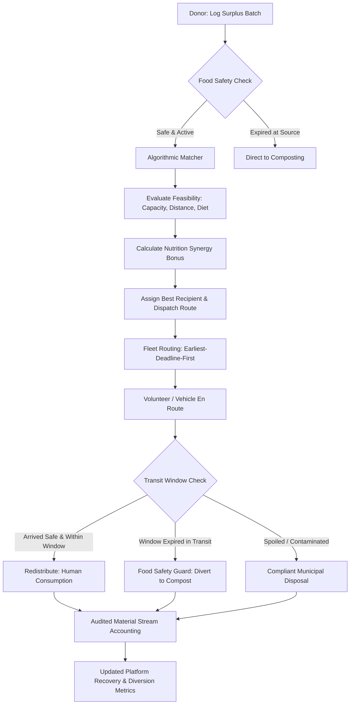
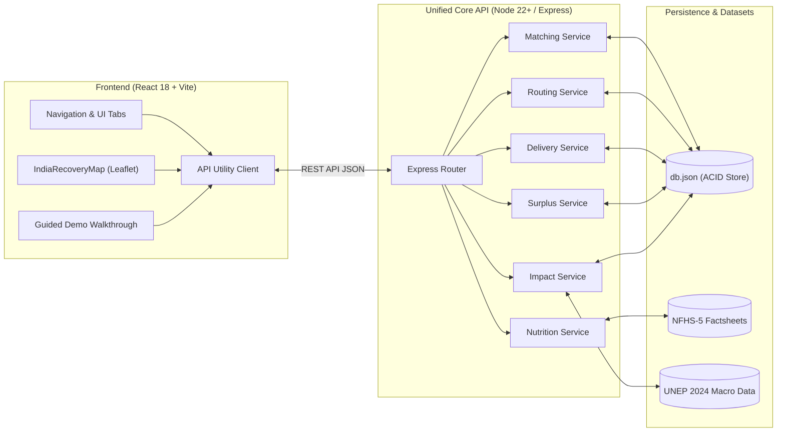

# Sociothon 2026: Smart Food Waste Prevention, Recovery & Redistribution

> A decentralized, technology-driven food waste prevention, collection logistics, and resource recovery platform developed for **Sociothon 2026 (NSS IIT Roorkee)** under the theme **Smart and Sustainable Waste Management**. Unifies open components from **Anya** and **ReRoute** into an operational, closed-loop waste management system.

[](https://sociothon-nutrition-food-redistribution.onrender.com/)
[](https://nodejs.org/)
[](https://react.dev/)
[](https://www.typescriptlang.org/)
[](https://vitejs.dev/)
[](https://tailwindcss.com/)
[]()
[]()
[]()

---

## Live Demo & Quick Links

- **Deployed Live Application**: [https://sociothon-nutrition-food-redistribution.onrender.com/](https://sociothon-nutrition-food-redistribution.onrender.com/)
- **GitHub Repository**: [https://github.com/ch-s-h-04/Sociothon-Nutrition-Food-Redistribution](https://github.com/ch-s-h-04/Sociothon-Nutrition-Food-Redistribution)
- **Local Endpoint**: `http://localhost:5000` (API Health: `http://localhost:5000/api/health`)
- **Interactive Evaluator Walkthrough**: Launch the live app and click the **Guided Sociothon Demo** tab for a self-guided 7-step tour through the complete food recovery lifecycle.

---

## Problem Statement

Institutional food operations—such as campus dining halls, university messes, hostel canteens, and catering services—generate substantial volumes of organic surplus daily. However, managing this surplus faces critical systemic challenges:

1. **Narrow Safe Consumption Windows**: Prepared food degrades rapidly. Without immediate temperature controls (hot holding $\ge 60^\circ\text{C}$, cold chain $\le 4^\circ\text{C}$) and rapid matching, surplus becomes spoiled food waste within hours.
2. **Fragmented Collection Logistics**: Disorganized manual communication between food donors and community organizations leads to delayed pickups, uncoordinated vehicles, and avoidable food spoilage in transit.
3. **Lack of Multi-Pathway Diversion**: Traditional charity redistribution operates on an all-or-nothing basis: if food cannot be delivered in time for human consumption, it is dumped into municipal landfills, generating methane emissions.
4. **Absence of Audited Material Accounting**: Institutions lack data-backed metrics on how much material was diverted from landfills, redistributed, or composted.

### Alignment with Sociothon 2026
This platform addresses the **Sociothon 2026** challenge statement:
> *"Develop an innovative, affordable, and scalable technology-driven solution that improves waste segregation, collection, recycling, monitoring, or resource recovery."*

Our focus is **prevention, source segregation, deadline-aware collection routing, food safety enforcement, and multi-pathway resource recovery** (human redistribution vs. organic bio-composting).

---

## Our Solution: Closed-Loop Food Waste Lifecycle

The platform operationalizes a five-stage closed-loop lifecycle that intercepts edible food before safe consumption windows expire, en route-optimizes collection, enforces safety guards, and ensures non-edible organic fractions are diverted to bio-composting:

```
[ Institutional Donors ]  (Dining Halls, Canteens, Caterers)
            │
            ▼
┌──────────────────────────────────────────────────────────┐
│ 1. Source Segregation & Logging                          │
│    • Category segregation (Cooked, Produce, Bakery, etc) │
│    • Temperature specs (Hot Holding, Cold Chain, Ambient)│
│    • Weight conversion (portions ➔ kg) & Expiry windows  │
└───────────────────────────┬──────────────────────────────┘
                            │
                            ▼
┌──────────────────────────────────────────────────────────┐
│ 2. Smart Algorithmic Matching                            │
│    • Operational feasibility: Capacity, radius (≤50 km)  │
│    • Travel ETA & circuity distance (Haversine × 1.35)   │
│    • Supporting nutrition synergy (NFHS-5 vulnerability) │
└───────────────────────────┬──────────────────────────────┘
                            │
                            ▼
┌──────────────────────────────────────────────────────────┐
│ 3. Earliest-Expiry-First Collection Routing              │
│    • Routing prioritized by shortest remaining expiry    │
│    • Fleet capacity & consolidation hub optimization     │
└───────────────────────────┬──────────────────────────────┘
                            │
                            ▼
┌──────────────────────────────────────────────────────────┐
│ 4. Multi-Pathway Quality Verification & Handover         │
│    ├── Safe & Within Deadline ──► Human Redistribution   │
│    ├── Past Safe Window       ──► Organic Bio-Composting │
│    └── Spoiled/Contaminated   ──► Compliant Disposal     │
└───────────────────────────┬──────────────────────────────┘
                            │
                            ▼
┌──────────────────────────────────────────────────────────┐
│ 5. Audited Material Accounting & Real-Time Monitoring   │
│    • Audited ledger: kg registered, collected, rescued   │
│    • Material Recovery Rate (%) & Diversion Rate (%)     │
│    • Verified recovery and diversion weights              │
└──────────────────────────────────────────────────────────┘
```

---

## Key Features

### 1. Waste Monitoring & Impact
- **Audited Material Stream Ledger**: Real-time operational accounting of kilograms registered, collected, redistributed to communities, diverted to composting, and disposed.
- **Diversion & Recovery Rates**: Automatic calculation of **Material Recovery Rate (%)** and **Redistribution Rate (%)** derived directly from persistent database records.
- **National Household Food Waste Benchmark**: Displays the verified baseline of **78.2 Million Tonnes/year** from the **UNEP Food Waste Index Report 2024** alongside a deterministic cumulative projection ticker ($~2,479.46\text{ kg/sec}$), clearly distinguished from local platform operations.

### 2. India's Food Recovery Network
- **Interactive CARTO Dark Map**: Leaflet-based map visualizing 8 regional state coordination hubs (Maharashtra, Delhi NCR, Karnataka, Tamil Nadu, West Bengal, Gujarat, Rajasthan, Uttar Pradesh).
- **Priority-Coded Nodes**: Vector circle markers color-coded by recovery urgency (*Critical*, *High*, *Active*).
- **Regional Gauges**: Interactive cards comparing daily surplus generation potential ($kg/\text{day}$) against community shortage deficits ($\text{meals}/\text{day}$) based on ReRoute benchmark datasets.

### 3. Surplus Prevention & Logging
- **Source Segregation**: Categorizes batches into Cooked Meals, Raw Produce, Bakery, Dairy, Packaged Goods, or Beverages.
- **Storage Temperature Guard**: Enforces storage handling specs (`hot_holding` $\ge 60^\circ\text{C}$, `cold_storage` $\le 4^\circ\text{C}$, or `ambient`).
- **Batch Weight Calculation**: Automatically converts meal portion counts to verified metric kilograms using category density factors ($0.38\text{ kg/meal}$ for cooked meals).
- **Real-Time Expiry Countdown**: Dynamic timers tracking remaining hours/minutes until safe consumption windows elapse.

### 4. Smart Recipient Matching
- **Algorithmic Compatibility Score (0–100)**: Evaluates candidate NGOs using multi-objective optimization:
  $$\text{Score} = w_1 \cdot \text{DistanceScore} + w_2 \cdot \text{CapacityScore} + w_3 \cdot \text{DietaryMatch} + w_4 \cdot \text{NutritionSynergy}$$
- **Operational Feasibility Filters**: Enforces strict constraints—rejects candidates exceeding vehicle capacities, radius limits ($>50\text{ km}$), or dietary conflicts.
- **Road Circuity & Travel ETA**: Incorporates realistic road circuity ($1.35\times$ Haversine factor) and urban speed models to estimate true transport time.
- **Supporting Nutrition Synergy**: Awards up to $+25$ points when food nutrient profiles (iron, protein, micronutrients) match high-vulnerability districts identified in NFHS-5 factsheets.

### 5. Collection Fleet & Routing
- **Earliest-Expiry-First Scheduling**: Sequences collection stops to pick up the most perishable food batches first, preventing spoilage in transit.
- **K-Medoids Hub Consolidation**: Algorithmic hub location optimization that identifies optimal transfer points to minimize total vehicle travel distance.
- **Simulated Fleet Dispatch**: Real-time visual radar of collection vehicles, assigned donor pickups, and capacity utilization.

### 6. Collection & Recovery Tracking (Multi-Pathway Handover)
- **Lifecycle State Machine**: Tracks donations through active stages (`assigned` $\rightarrow$ `in_transit` $\rightarrow$ `delivered` / `diverted_to_compost` / `disposed`).
- **Dual-Pathway Handover**:
  - **Redistribute (Edible)**: Verifies safe human delivery to the assigned NGO.
  - **Divert to Compost**: Records diversion of degraded or past-safe-window food to a local aerobic bio-composter.
- **Automated Food Safety Guard**: If a food batch's safe consumption window expires, human redistribution is automatically disabled, enforcing safe diversion to composting or disposal.

### 7. Nutrition Intelligence (Supporting)
- **NFHS-5 Factsheet Integration**: District-level child malnutrition data (stunting %, wasting %, anemia %) across Indian aspirational districts.
- **Geographic Vulnerability Prioritization**: Allows operators to target food recovery initiatives to areas experiencing acute nutritional deficits.

### 8. Guided Sociothon Demo
- **6-Step Judge Walkthrough**: Built-in interactive evaluator wizard that guides reviewers through logging surplus, algorithmic matching, dispatching routes, executing multi-pathway handover, and observing immediate impact ledger updates.

### 9. Provider Trust Leaderboard
- **Food Recovery Partner Reputation**: Publicly ranks active providers using a transparent Trust Score: reliability (30%), NGO post-handover ratings (30%), food-safety confidence (20%), successful NGO handovers (15%), and capped verified activity (5%). Donation quantity does not affect rank.

---

## Screenshots & Product Preview

Usable interface captures can be saved to [`docs/screenshots/`](./docs/screenshots/). Reviewers can experience the live interfaces directly at the [Live Demo](https://sociothon-nutrition-food-redistribution.onrender.com/):

| View | Description | Key Elements |
|---|---|---|
| **Waste Monitoring & Impact** | Executive waste ledger & national benchmark | UNEP 2024 78.2 MT baseline, live ticker, audited recovery rates |
| **India Recovery Network** | Regional multi-hub spatial map | Leaflet dark CARTO map, 8 state hubs, surplus vs. shortage gauges |
| **Surplus Prevention & Logging** | Source segregation & batch intake | Food categorization, storage requirements (>60°C / <4°C), expiry countdown |
| **Smart Recipient Matching** | Constraint & synergy matching engine | Compatibility scores, road distance/ETA, vehicle capacities, nutrition synergy |
| **Collection Fleet & Routing** | Logistics optimization | Earliest-deadline-first routing, K-medoids hubs, fleet capacity tracking |
| **Collection & Recovery Tracking** | Dual-pathway handover & safety guard | In-transit state machine, "Redistribute" vs. "Divert to Compost", safety lock |
| **Guided Sociothon Demo** | Evaluator walkthrough wizard | 7-step guided journey through donation lifecycle |

> *To capture or contribute local screenshot images, refer to the [Capture Guide in docs/screenshots/](./docs/screenshots/README.md).*

---

## How It Works

The platform acts as an **operational decision-support, routing, and verification workflow platform** connecting food donors, logistics volunteers, and community recipients:



> **Clarification**: The software is a digital coordination and decision-support system. It schedules pickups, models transit feasibility, enforces food safety policies, and accounts for material diversion. Physical food collection and transport are carried out by participating campus teams, partner NGOs, or volunteer fleets.

---

## Technology Stack & Architecture

### Verified Technologies
- **Frontend**: React 18.3, TypeScript 5.7, Vite 5.4, Tailwind CSS 3.4, Lucide React icons, Leaflet 1.9.4 with CARTO dark basemap tiles.
- **Backend**: Node.js 22/24 with native TypeScript type stripping (`node --experimental-strip-types`), Express 4.21, CORS.
- **Persistence Layer**: Zero-external-dependency ACID file store (`server/db/store.ts`) operating with atomic file writes to `server/data/db.json`. Does not require external database containers.
- **Test Framework**: Native Node.js Test Runner (`node --test`), 19 unit and integration tests.
- **Deployment**: Render Web Service (configured via `render.yaml`, Node runtime pinned via `.node-version: 22.12.0`).

### System Architecture Diagram



---

## Data Sources, Assumptions & Methodology

To ensure transparency, data within the platform is categorized by provenance:

| Category | Dataset / Indicator | Source | How It Is Used |
|---|---|---|---|
| **Official Published Statistics** | India Household Food Waste (78,192,338 tonnes/year, Medium Confidence) | [UNEP Food Waste Index Report 2024](https://wedocs.unep.org/items/dbe2cd4c-8384-4636-8359-5847f42b9711) | Macroeconomic benchmark displayed in the monitoring dashboard. |
| **Official Published Statistics** | District Malnutrition Rates (Stunting, Wasting, Anemia) | [National Family Health Survey (NFHS-5, 2019–2021)](http://rchiips.org/nfhs/factsheet_NFHS-5.shtml) | Baseline district profiles and nutritional vulnerability prioritization. |
| **Operational Platform Records** | Donations registered, pickups, deliveries, composted weights | `server/data/db.json` (Platform Database) | Computes audited material diversion and recovery rates. |
| **Modelled Estimates** | Live Cumulative Household Waste Ticker | Mathematical formula: $78,192,338\text{ t} \times 1,000 \div 31,536,000\text{ s} \approx 2,479.46\text{ kg/s}$ | Illustrative statistical projection (not live sensor measurement). |
| **Modelled Estimates** | Road Distance & Travel Time | Haversine formula with $1.35\times$ circuity factor & urban speed model | Predicts route travel feasibility. |
| **Synthetic Demonstration Data** | Initial campus dining halls, canteens, volunteer vehicles, sample NGOs | Local Seed Store | Provides realistic demonstration records for hackathon evaluation. |

---

## Impact & Scalability

### Potential Environmental & Social Impact
- **Methane Prevention**: Every kilogram of organic food diverted from anaerobic landfill decomposition prevents methane emissions ($\sim 25\times$ more potent than $\text{CO}_2$ over 100 years).
- **Resource Recovery**: Composting spoiled fractions yields organic soil conditioner ($0.25\text{ kg}$ finished compost per kg wet food waste), returning nutrients to community gardens and institutional landscaping.
- **Nutritional Equity**: Ensuring prepared surplus reaches shelters and kitchens within safe consumption windows converts potential waste into immediate meals.

### Scalability Pathways
1. **Phase 1 (Current Prototype)**: Campus dining halls, hostels, and canteens within university environments (e.g., IIT Roorkee).
2. **Phase 2**: Expansion to municipal banquets, convention centers, corporate cafeterias, and wedding caterers.
3. **Phase 3**: Integration with municipal decentralized bio-methanation and composting facilities for seamless organic waste routing.

> *Note: Metrics shown in the operational ledger represent recorded software transactions; actual impact figures depend on physical execution by operational partners.*

---

## Installation & Local Development

### Prerequisites
- **Node.js**: Version **22.6.0 or higher** (developed and tested on Node.js `v24.15.0`). Pinned to `22.12.0` in `.node-version`.
- **npm**: Version **10+** (bundled with Node.js).
- **Git**: For cloning the repository.

### Quickstart Commands

```bash
# 1. Clone the repository
git clone https://github.com/ch-s-h-04/Sociothon-Nutrition-Food-Redistribution.git
cd Sociothon-Nutrition-Food-Redistribution

# 2. Install dependencies
npm install

# 3. Environment configuration (Optional)
# Copy example environment variables if you plan to use CARTO map tiles
cp .env.example .env
# Set VITE_CARTO_API_KEY in .env if you have a CARTO Basemap key (carto.com/basemaps/apikey)

# 4. Run automated test suite
npm test

# 5. Build production bundle
npm run build

# 6. Start the unified production server
npm start
```

The application will be accessible at:
- **Web Platform**: [`http://localhost:5000`](http://localhost:5000)
- **API Health Check**: [`http://localhost:5000/api/health`](http://localhost:5000/api/health)

### Development Mode (with Hot Module Replacement)
```bash
npm run dev
```

---

## Demo Guide for Judges (5–7 Minute Walkthrough)

To experience the platform during hackathon evaluation:

1. **Open the Application**: Navigate to [`https://sociothon-nutrition-food-redistribution.onrender.com/`](https://sociothon-nutrition-food-redistribution.onrender.com/) (or local `http://localhost:5000`).
2. **Step 1 — Waste Monitoring & Impact** (Tab: `Waste Monitoring & Impact`):
   - Review the **Estimated Annual Household Food Waste in India: 78.2 Million Tonnes** (UNEP 2024 baseline) and the live projection counter.
   - Explore **India's Food Recovery Network**: Click on state nodes on the dark CARTO map to inspect regional surplus vs. shortage figures.
   - Review the **Audited Material Waste Stream & Recovery Accounting** grid.
3. **Step 2 — Log a New Surplus Batch** (Tab: `Surplus Prevention & Logging`):
   - Click **"Log Surplus Batch"**.
   - Select food category (e.g., *Cooked Meals*), quantity (e.g., *80 meals*), storage requirement (*Hot Holding $\ge 60^\circ\text{C}$*), and set a safe consumption deadline.
   - Notice that the system automatically calculates batch weight ($30.4\text{ kg}$) and tracks safe consumption hours remaining.
4. **Step 3 — Match with an Optimal Recipient** (Tab: `Smart Recipient Matching`):
   - Select your logged batch from the surplus selector dropdown.
   - Observe how candidate NGOs are evaluated for distance, travel ETA, vehicle capacity feasibility, and nutrition synergy.
   - Click **"Assign Donation & Dispatch Route"** on the top-ranked recommendation.
5. **Step 4 — Inspect Fleet Routing** (Tab: `Collection Fleet & Routing`):
   - Observe the assigned vehicle's pickup schedule, sequenced by **earliest deadline first** with realistic $1.35\times$ road circuity.
6. **Step 5 — Handover & Quality Verification** (Tab: `Collection & Recovery Tracking`):
   - Find your active dispatch and click **"Start Collection / En Route"**.
   - Test the **Dual-Pathway Handover**:
     - *If food is fresh*: Click **"Redistribute (Edible)"** to log human delivery.
     - *If food passed its deadline*: Notice the **Food Safety Guard** blocks human delivery and prompts **"Divert to Compost"**. Click it to record bio-composting diversion.
7. **Step 6 — Verify Real-Time Impact Ledger** (Return to Tab: `Waste Monitoring & Impact`):
   - Observe how the audited material recovery metrics (kg collected, kg redistributed or composted, and recovery rate %) update immediately.
8. **Resetting Demo Data**:
   - At any time, click **"Reset Seed Data"** in the top navigation bar to restore the sample database to its clean baseline.

---

## Testing & Validation

The codebase includes an automated test suite executed via the native Node.js test runner:

```bash
npm test
```

### Verified Test Results (18/18 Passing):
```text
> sociothon-nutrition-food-redistribution@1.0.0 test
> node --test tests/**/*.test.mjs

✔ End-to-End Workflow: Nutrition Data -> Risk Prioritization -> Surplus Registration -> Smart Matching -> Route Planning -> Delivery -> Impact Reflection (34.8ms)
✔ Sociothon 2026: Multi-Pathway Recovery, Composting Diversion & Food Safety Guard (16.6ms)
✔ Matching: Haversine distance is non-negative and symmetric (1.6ms)
✔ Matching: Travel time calculation incorporates road factor and speed model (0.4ms)
✔ Matching: evaluateNutritionSynergy boosts iron/protein foods for vulnerable districts (0.4ms)
✔ Matching: findNGORecommendations enforces constraints and ranks top recipient (5.6ms)
✔ Nutrition: getRiskLevel categorizes percentages properly (1.5ms)
✔ Nutrition: getAllDistrictSummaries returns verified NFHS-5 factsheet districts (1.2ms)
✔ Nutrition: getDistrictById returns full micronutrient profile and provenance (1.0ms)
✔ Routing: generateInterpolatedWaypoints produces valid coordinate paths (2.0ms)
✔ Routing: optimizeFleetRoutes respects vehicle capacities and deadline feasibility (3.3ms)
✔ Routing: optimizeHubLocations selects medoids among donor locations (1.4ms)
✔ Surplus: calculateFoodWeightKg converts standard meals to kilograms (1.4ms)
✔ Surplus: CRUD lifecycle maintains persistent records and status transitions (9.0ms)
✔ UNEP 2024 Household Food Waste: Constants and Mathematical Derivation (1.9ms)
✔ Deterministic Counter Calculation: Monotonic, Repeatable, No Refresh Jumps (0.5ms)
✔ Server Impact Metrics: UNEP 2024 Integration and Provenance (1.7ms)

ℹ tests 19
ℹ pass 19
ℹ fail 0
ℹ duration_ms ~360ms
```

### Production Build Verification
```bash
npm run build
```
- **Vite 5.4 Production Build**: Successfully transforms and bundles 1962 modules with zero TypeScript or CSS errors (`dist/index.html` 1.13 kB, `dist/assets/index-*.js` ~436 kB gzip: 121 kB).

---

## Limitations & Future Roadmap

### Current Limitations
1. **In-Memory / File-Backed Database**: The current prototype uses a local JSON ACID store (`server/data/db.json`). While reliable for demonstrations, production scaling requires a managed PostgreSQL / PostGIS instance.
2. **Simulated GPS Fleet Telematics**: Route progress and vehicle coordinates are simulated mathematically using Haversine distance and speed models rather than live IoT OBD-II / GPS telematics hardware.
3. **External Tile Service Dependency**: High-resolution dark map tiles depend on CARTO basemap availability. If an API key is not configured, a clear configuration warning is displayed.

### Future Roadmap
- **IoT Smart Bins & Temperature Sensors**: Integrate Bluetooth / LoRaWAN food probes to continuously log hot/cold holding temperatures in transit.
- **Driver Mobile PWA**: Dedicated mobile view with turn-by-turn navigation and offline barcode verification for pickup/dropoff scans.
- **Municipal Composting Marketplace**: Direct API integration with local organic compost processing yards and biogas digesters to automate bulk collection dispatch.

---

## Acknowledgements & Source Attribution

This repository integrates, enhances, and builds upon open-source components originally created by **Dishank Sen**:
- **Anya — India's Nutrition Copilot**: [https://github.com/Dishank-Sen/Anya](https://github.com/Dishank-Sen/Anya)
- **ReRoute — Intelligent Food Recovery Network**: [https://github.com/Dishank-Sen/ReRoute](https://github.com/Dishank-Sen/ReRoute)

For detailed component mapping and notices, see [ATTRIBUTION.md](./ATTRIBUTION.md).

### License
This project is open-source under the [MIT License](./LICENSE).
